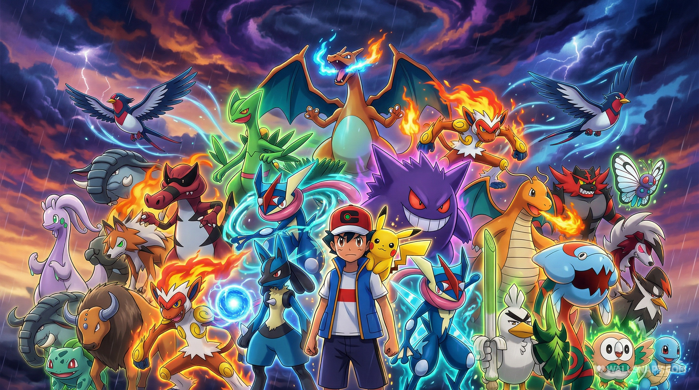
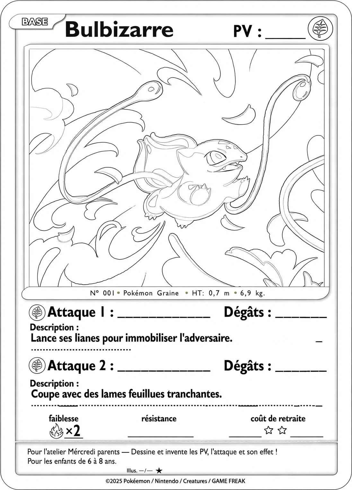
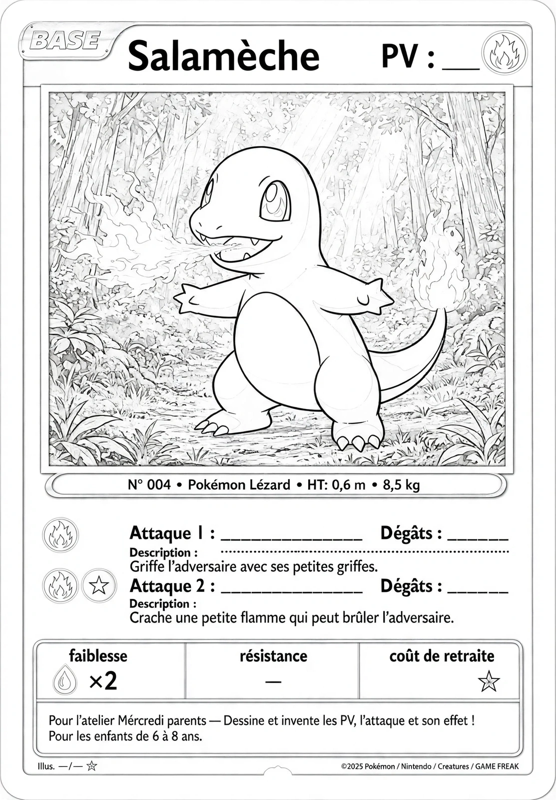
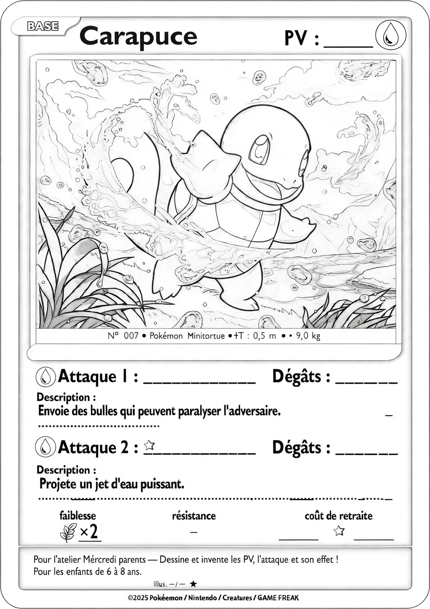
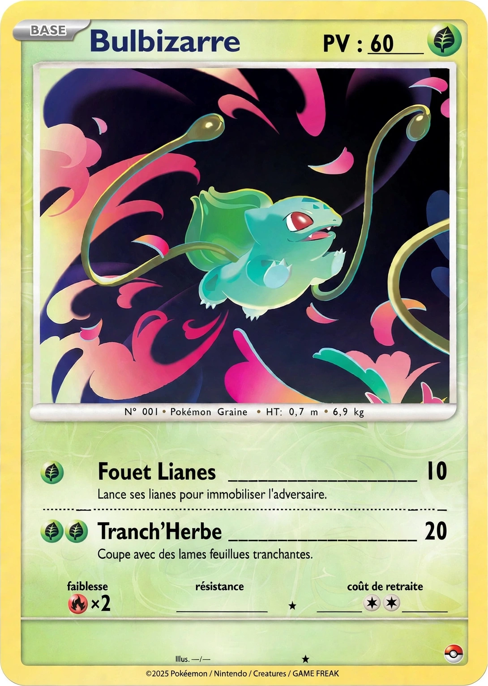
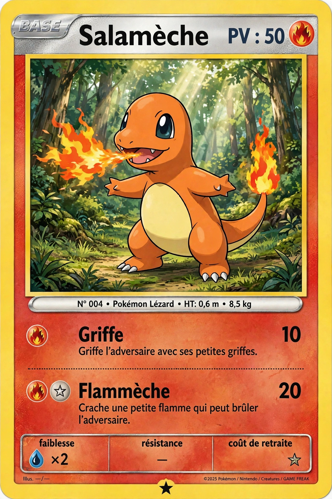
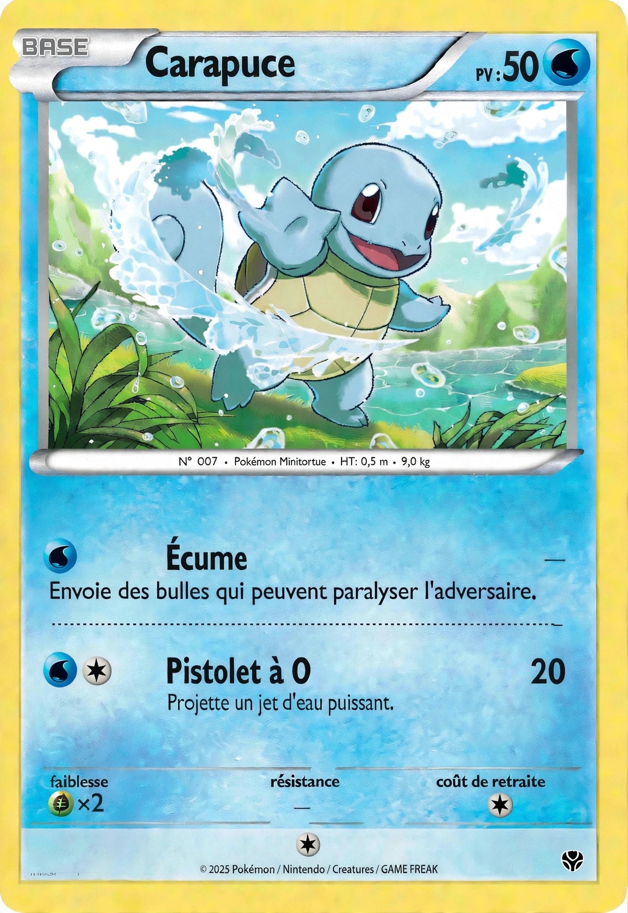

# Les Pokémon

## Agenda

| Heure de début | Heure de fin | Activité | Animateur |
| -------------- | ------------ | -------- | --------- |
| 8h00 | 8h05 | Accueil des élèves | Raphaël et Morgane |
| 8h05 | 8h20 | Causerie d'ouverture : le monde Pokémon, Sacha et Pikachu, medley | Raphaël |
| 8h20 | 9h35 | Activité 1 — Atelier cartes : choix du starter et carte à colorier | Morgane |
| 9h35 | 10h05 | Collation (temps scolaire) | |
| 10h05 | 10h25 | Récréation dehors, avec l'équipe du service de garde | |
| 10h25 | 10h55 | Activité 2 — Jeux physiques au gymnase | Raphaël |
| 10h55 | 11h15 | Activité 3 — Lecture d'une histoire + questions / réponses de clôture | Morgane |
| 11h15 | 11h20 | Rangement | |
| 11h20 | 11h25 | Retour de l'enseignante et bilan avec le groupe | Anouska |

## Détails

### Accueil et causerie d'ouverture

Raphaël présente le monde Pokémon : des créatures aux pouvoirs variés, des dresseurs qui voyagent de région en région, une histoire qui dure depuis 1996 (jeux vidéo, série animée, films).
Le fil conducteur : Sacha et son Pikachu.

Puis présentation du medley de Pokémon choisis en famille, pour lancer les réactions de la classe : lesquels ils connaissent, lesquels les intriguent.

[Voir le carrousel Top 10](https://muse.ai/s/carrousel-top-10-pokemon-gxc6xsxsuxmxlrxd4/2-tIhICrGSLiUSQnMFiRQRsTew2N2c8c5W53yYN-Oug)

Anecdotes vérifiées sur Poképédia.
Mode d'emploi : faites défiler les images une par une et lisez l'anecdote à voix haute — une par Pokémon, pour clore l'introduction en beauté avant l'atelier cartes.

Questions aux enfants :
- Qui connaît déjà les Pokémon ? Lesquels ?
- C'est quoi, un dresseur Pokémon ?
- Est-ce que vous avez déjà vu un film ou un épisode Pokémon ?

Petite anecdote : au Québec, les premiers épisodes diffusés utilisaient les noms anglais (Ash, Charmander, Bulbasaur), parce que les premiers jeux vendus ici étaient les versions américaines.
Depuis 2014, la série diffusée au Québec utilise les noms français, comme partout ailleurs en francophonie.

### Atelier cartes : choix du starter et carte à colorier

Chaque enfant choisit son Pokémon de départ parmi les trois starters de la première génération : **Bulbizarre** (Plante), **Salamèche** (Feu), **Carapuce** (Eau).

Déroulement :

1. Les cartes imprimées sont mélangées dans 3 files (une par starter).
2. Les enfants viennent choisir leur starter un par un.
3. Chaque carte est imprimée en noir et blanc, sans couleurs : les enfants la colorient.
4. La carte donne la description des 2 attaques, et les enfants inventent et écrivent eux-mêmes : le nom de chaque attaque, les dégâts et les PV.
5. Option : au dos, dessiner l'évolution du starter (Herbizarre, Reptincel, Carabaffe) en avant-goût.

**Quantités (16 enfants) :** 8 cartes par starter, soit 24 cartes au total.

  
  
  

  <strong>Exemples :</strong>

  
  
  

### Jeux physiques au gymnase

Les jeux se déroulent au gymnase, en intérieur.
Le groupe de chaque enfant est défini par le starter choisi à l'atelier précédent.

### Lecture d'une histoire

Retour en classe pour un moment calme avec la lecture d'un livre en lien avec le thème, suivi des questions / réponses de clôture (quel starter as-tu choisi, et pourquoi ? qu'as-tu retenu ?).
Le livre sera choisi avec Rose et Joy, puis sa disponibilité à la bibliothèque sera vérifiée.

### Quiz (optionnel)

Quiz en fin d'atelier cartes, si le temps le permet — à confirmer avec Morgane.

### Rangement et bilan

Rangement de la classe (11h15–11h20), puis retour de l'enseignante Anouska et bilan de l'activité avec le groupe (11h20–11h25).

## Matériel

- 24 cartes starters imprimées en noir et blanc (8 × Bulbizarre, 8 × Salamèche, 8 × Carapuce) + quelques copies de réserve
- Crayons de couleur / feutres (assez pour 16 enfants)
- Application compagnon (carrousel du medley) + écran ou projecteur pour l'introduction
- Matériel gymnase : plots / cerceaux pour le parcours (à confirmer selon le matériel disponible)
- Livre choisi (à confirmer)

---

### Autres ressources

- [Poképédia](https://www.pokepedia.fr) — l'encyclopédie francophone de référence sur l'univers Pokémon
- [Site officiel Pokémon en français](https://www.pokemon.com/fr)
- Le carrousel animé du Top 10 est en ligne : [Voir le carrousel Top 10](https://muse.ai/s/carrousel-top-10-pokemon-gxc6xsxsuxmxlrxd4/2-tIhICrGSLiUSQnMFiRQRsTew2N2c8c5W53yYN-Oug).
